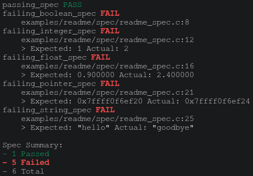

# specc

## Unit testing framework for C/C++

Example test suite using specc
```C
#include "../../../src/specc.h"

spec(passing_spec)(spec_t *s) {
  should(s, 1 == 1);
}

spec(failing_boolean_spec)(spec_t *s) {
  should(s, 1 == 0);
}

spec(failing_integer_spec)(spec_t *s) {
  should_eq(s, 1, 2, int);
}

spec(failing_float_spec)(spec_t *s) {
  should_eq(s, 0.9f, 2.4f, float);
}

spec(failing_pointer_spec)(spec_t *s) {
  int a, b;
  should_eq(s, &a, &b, int*);
}

spec(failing_string_spec)(spec_t *s) {
  should_str_eq(s, "hello", "goodbye");
}
```

Output:



## Current Comparison Support
* `should`
* `should_not`
* `should_eq` (for primitives)
* `should_not_eq` (for primitives)
* `should_str_eq`
* `should_str_not_eq`
* `should_double_eq` (with given err)
* `should_double_not_eq` (with given err)

You can also implement your own custom comparisons. An example of this can be found in examples/custom


## Stubbing
The only support specc has for any kind of 'stubbing' is a `#define SPECC` to allow different behavior when tests are being run.

# Building
## Custom
specc's entry point is in `src/specc.c` so all you have to do is
```
gcc -c src/specc.c
```
and then link all of your spec files.

## Makefile
```
# alternatively, `make spec-auto`
make spec
```

Right now, the Makefile is configured to run the simple example, but it isn't too hard to change it for your needs.